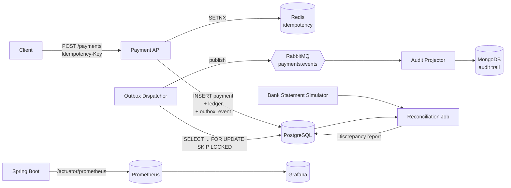

# fintech-event-driven-reconciliation-engine

A fault-tolerant, event-driven payment and financial reconciliation engine built with Java 21, Spring Boot 3, PostgreSQL, RabbitMQ and Redis. The focus is a single hard problem: **data consistency across services in a distributed financial system**.

Three patterns do the heavy lifting:

- **Idempotency Key** stops duplicate charges when the client retries.
- **Transactional Outbox** guarantees that every ledger write produces exactly one event, even if the broker is down.
- **Reconciliation Job** diffs the internal ledger against an external bank statement and reports every discrepancy.

## Architecture



## Why these patterns

### Idempotency Key
Payment calls go over flaky networks. The client retries, the server has no idea whether the first call reached it. The `Idempotency-Key` header plus a short-lived Redis `SETNX` lock turns the second call into a replay of the first response instead of a second charge. The database also carries a `UNIQUE (merchant_id, idempotency_key)` constraint so a lost Redis entry still cannot double-insert.

### Transactional Outbox
Writing to the database and publishing to RabbitMQ cannot share a transaction. If we publish first and the DB commit fails, downstream consumers see a payment that was never recorded. If we commit first and the publish fails, the ledger holds a payment nobody downstream knows about. Writing the event into an `outbox_events` row inside the same JDBC transaction as the ledger write collapses both into one atomic unit. A background worker then polls the outbox with `SELECT ... FOR UPDATE SKIP LOCKED`, publishes to RabbitMQ, and marks the row `PUBLISHED` — at-least-once delivery, with the broker as the only moving part.

### Reconciliation Job
Even with the outbox, external systems drift. The bank reports an amount we never recorded, a payment we booked never settles, a currency gets mis-tagged. A nightly job pulls the latest statement, left-joins it against the ledger over `(external_ref, amount, currency)`, and writes a `discrepancies` row for every mismatch. Operations works off that table, not off log lines.

## Running

Everything comes up with one command:

```bash
docker-compose up --build
```

That starts Postgres, Mongo, Redis, RabbitMQ, Prometheus, Grafana, and the application. Flyway runs the migrations on startup.

| Service     | URL                              |
| ----------- | -------------------------------- |
| API         | http://localhost:8080            |
| Actuator    | http://localhost:8080/actuator   |
| Prometheus  | http://localhost:9090            |
| Grafana     | http://localhost:3000 (admin/admin) |
| RabbitMQ UI | http://localhost:15672           |

### Local development without Docker

Dependencies: JDK 21, Maven 3.9+, Docker (for Postgres/Mongo/Redis/RabbitMQ).

```bash
docker-compose up -d postgres mongo redis rabbitmq
./mvnw spring-boot:run
```

### Tests

Testcontainers spins up ephemeral containers for every integration test.

```bash
./mvnw test
```

## Database schema

PostgreSQL migrations live under `src/main/resources/db/migration/`:

| Migration | Tables |
| --------- | ------ |
| V1 | `payments`, `ledger_entries` |
| V2 | `outbox_events` |
| V3 | `bank_statements`, `reconciliation_runs`, `discrepancies` |
| V4 | `saga_instances` |

Amounts are stored as `BIGINT` minor units (kuruş, cents) — never floats.

## Example: discrepancy report

```json
[
  {
    "runId":            "a3f7...",
    "discrepancyType":  "AMOUNT_MISMATCH",
    "paymentId":        "9e8b...",
    "externalRef":      "BNK-2026-11-02-00042",
    "expectedAmount":   125000,
    "actualAmount":     124900,
    "currency":         "TRY",
    "detectedAt":       "2026-11-03T02:15:04Z"
  },
  {
    "runId":            "a3f7...",
    "discrepancyType":  "MISSING_IN_LEDGER",
    "bankStatementId":  "0c71...",
    "actualAmount":     450000,
    "currency":         "TRY",
    "detectedAt":       "2026-11-03T02:15:04Z"
  }
]
```

## Tech stack

| Layer         | Choice |
| ------------- | ------ |
| Language      | Java 21 |
| Framework     | Spring Boot 3.3 |
| Persistence   | PostgreSQL 16 + Flyway + Spring Data JPA |
| Audit store   | MongoDB 7 |
| Cache / locks | Redis 7 (Lettuce) |
| Messaging     | RabbitMQ 3.13 |
| Observability | Micrometer + Prometheus + Grafana + OpenTelemetry OTLP |
| Testing       | JUnit 5 + Testcontainers + Awaitility |

## Project layout

```
src/main/java/com/ruvi/reconciliation/
├── api/                 REST controllers
├── application/         use cases, orchestrators (payment, outbox, reconciliation)
├── domain/              aggregates, value objects, domain events
└── infrastructure/      JPA repos, RabbitMQ publisher, Mongo audit, config
```
